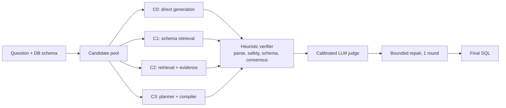

# NL2SQL with Open-Weight LLMs

Research part of my bachelor's thesis at HSE University (MIEM, 2026): a modular Text-to-SQL pipeline built entirely on open-weight models, evaluated on full Spider 1.0, BIRD and Spider 2.0 benchmarks.

**Key result:** with a single 7B model (Qwen2.5-Coder-7B-Instruct), the final pipeline raises execution accuracy on BIRD Mini-Dev from **20.4% to 38.8%** (+18.4 pp, p < 0.0001) and on Spider 1.0 dev from **72.5% to 76.8%** (+4.3 pp, p < 0.0001).

## Results

Execution accuracy (EX) on full benchmark splits, 95% Wilson confidence intervals in brackets.

| Benchmark | Baseline (B0) | Best in study (B6_v7) | Gain | McNemar p |
|---|---:|---:|---:|---:|
| Spider 1.0 dev (1,034 questions) | 72.5% | **76.8%** [74.1, 79.3] | +4.3 pp | < 0.0001 |
| BIRD Mini-Dev (500 questions) | 20.4% | **38.8%** [34.6, 43.1] | +18.4 pp | < 0.0001 |

All headline numbers come from full benchmark runs, not samples. Every phase is compared to the previous best with paired statistics. The full ladder of 9 phases, including negative results, is in **[RESEARCH_SUMMARY_FINAL.md](RESEARCH_SUMMARY_FINAL.md)**.

## Architecture

- **Schema linking and retrieval:** bidirectional BM25 + n-gram matching with foreign-key expansion.
- **Candidate generation:** four strategies produce SQL candidates in parallel.
- **Verifier:** rule-based checks for parse errors, unsafe statements, schema validity, intent and agreement between candidates.
- **LLM-as-judge:** the same 7B model selects the final candidate, with separate calibration for Spider and BIRD.
- **Spider 2.0:** a schema-first variant where Qwen3-Coder-30B-A3B-Instruct builds a JSON plan over a closed schema vocabulary, then SQL is rendered deterministically and validated with a dry run ([report](outputs/REPORT_SPIDER2_V18.md)).

## What worked and what did not

Negative results are documented as carefully as positive ones.

| Experiment | Outcome |
|---|---|
| Hybrid schema retrieval | Helps: +2.3 pp on Spider, large gain on BIRD with evidence |
| Controller with verifier | Helps: fixes the planner regression, +1.9 pp on Spider |
| Calibrated LLM judge | Helps: +4.8 pp on BIRD over the verifier-only controller |
| Planner without verifier | Hurts: -15.6 pp on Spider |
| Qwen3-Reranker-0.6B | Hurts: scores saturate, -2.8 pp on BIRD |
| Rich evidence layer, demo retrieval | No significant effect |

## Repository structure

| Path | Contents |
|---|---|
| `repo/src/evaluation/` | Pipeline modules (schema linking, retrieval, planner, candidate generator and selector, dialect normalizers, validators) and baselines B0 to B7 |
| `tools/`, `tools/remote_scripts/` | Experiment runners, local and GPU-side |
| `spider2_dbt_bridge/`, `colab_bridge/`, `snowflake_setup/`, `configs/` | Environments for Spider 2.0 DBT, BigQuery and Snowflake |
| `outputs/REPORT_*.md` | Per-phase reports |
| `outputs/metrics/`, `outputs/tables/`, `outputs/plots/` | Metrics, summary tables and plots |
| `outputs/final/` | Thesis materials by chapter (mostly in Russian) |

## Setup and compute

- Models: Qwen2.5-Coder-7B-Instruct, Qwen3-Coder-30B-A3B-Instruct (BF16)
- Hardware: NVIDIA A100 40 GB, about 70 to 80 GPU hours, 10,000+ full benchmark generations
- Stack: Python, PyTorch, Transformers, sqlglot
- Benchmark data, prediction files and run logs are not included. Download the datasets from the official Spider, BIRD and Spider 2.0 pages.

## Context

This repository is my part of a joint thesis project, NL2BI, extracted with full commit history from the [NL2BI-AI-assistant](https://github.com/petrussia/NL2BI-AI-assistant) repository. The BI layer and web interface remain there.

Author: Denis Shubin · [LinkedIn](https://www.linkedin.com/in/denisshubina/)
